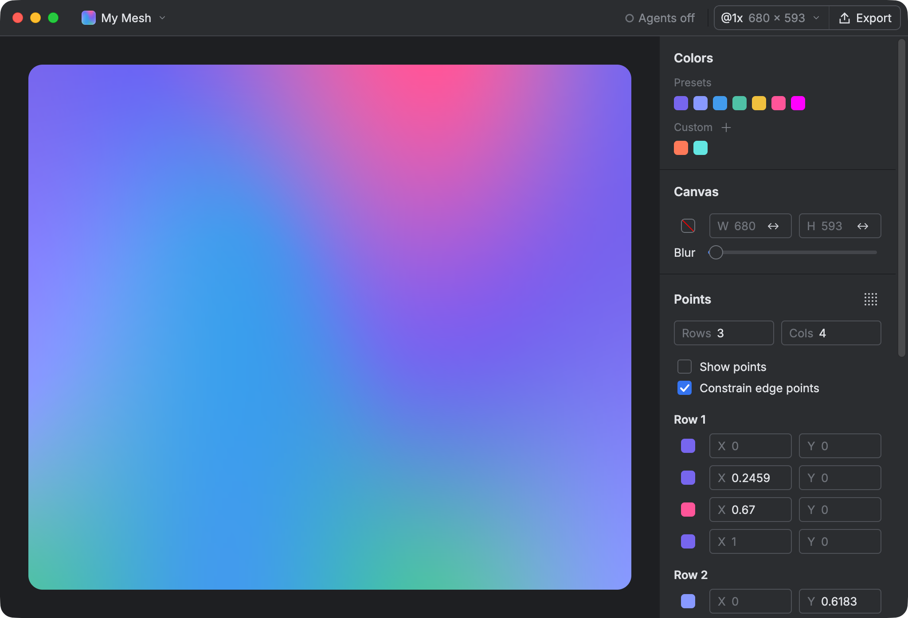

# Mesh

A desktop editor for creating mesh gradients in Compose, built with [Compose Multiplatform](https://www.jetbrains.com/compose-multiplatform/) and the [Jewel UI standalone toolkit](https://github.com/JetBrains/jewel). Gradients are rendered using Compose's official [`MeshGradientPainter`](https://developer.android.com/develop/ui/compose/graphics/draw/mesh-gradient), with bicubic color interpolation and Bezier control points that are inferred automatically unless you shape them.

## Features and controls

- **Grid:** Adjust between 2–64 rows and columns, or distribute points evenly.
- **Control points:** Drag points on the canvas or edit `X`/`Y` offsets in the side panel. Double-click the canvas to hide or show points, and toggle edge constraints to lock perimeter points to the canvas bounds.
- **Bezier handles:** Select a point on the canvas to show its tangent handles and connected curved mesh edges. Solid straight lines are handle guides; dashed curves show the actual Bézier edges, shaped by the handles at both ends. The active handle and edge are highlighted on the canvas. These editing overlays are not included in image exports. Use the four-dot button at the right of a point row to open its movable Control points editor, with compact X/Y fields in a 2×2 grid. Each pair's icon cycles between No mirroring (the default), Mirror angle (preserving the opposite handle's length), and Mirror angle and length. Modes are saved per point and pair, support undo/redo, and apply to subsequent canvas and popup edits of either handle in the pair. Reset all is the only reset action and appears beside the close button when handles have changed; it restores all four automatically inferred positions without changing the modes. Close the editor with its close button, Escape, or a click outside it. API edits can still set each handle independently.
- **Palette:** Use the global preset colors, add custom colors to the document, assign colors per point.
- **Canvas:** Configure canvas dimensions (fixed size or fill), background color, and blur.
- **Undo/redo:** Undo with ⌘Z (Ctrl+Z) and redo with ⇧⌘Z (Ctrl+Shift+Z or Ctrl+Y). Covers point, Bezier handle, grid, blur, background, and custom color edits, including ones an agent makes.
- **Export:** Copy Kotlin code for an official `MeshGradientPainter` and a `meshGradientModifier` that includes the current blur and required imports. Apply it to a sized Composable with `Modifier.then(meshGradientModifier)`, or export a PNG at 1x, 2x, or 3x scale. Both live in the export control at the end of the title bar, which names the pixel size it will produce.
- **Documents:** New/Open/Save work with `.mesh` files. A document holds its points, their Bezier handles, grid, canvas settings, background color, and custom colors by value, so it opens the same on any machine. Saved documents autosave to their `.mesh` file after each edit. Closing, quitting, New, or Open never silently drops edits. Mesh reopens the last document at launch, and on the first launch after upgrading, the mesh saved by earlier versions becomes `~/.mesh/Documents/My Mesh.mesh`.
- **Agent access (MCP):** Coding agents can read and edit the open mesh document through an MCP server. See [below](#agent-access-mcp).

### Roadmap

- [ ] Grain overlay
- [ ] Presets
- [ ] Gradient animation

## Agent access (MCP)

Mesh can serve an [MCP](https://modelcontextprotocol.io) server over streamable HTTP so an agent can edit the open mesh document you are looking at.

| Tool | What it does |
| --- | --- |
| `get_mesh` | Returns the open document's name and file, the grid, canvas settings, saved colors with their IDs, and each point's position, color, four Bezier handles, and mirroring modes; at most 256 points per call, so a bigger grid needs a `rowStart`/`rowEnd`/`colStart`/`colEnd` region holding at most 256 points, and a larger region is rejected |
| `set_grid` | Changes the grid size (2–64 rows and columns) and/or blur (0–1) as one undoable edit |
| `update_point` | Moves and/or recolors the point at a row and column, sets any of its four Bezier handles, and changes its mirroring modes in one undoable edit |
| `update_points` | Moves, recolors, and/or reshapes up to 4,096 points in a single undoable edit |
| `add_color` | Adds a color to the document's custom palette and returns its ID |
| `undo` / `redo` | Undoes or redoes the last edit, whether you or the agent made it |
| `render_png` | Renders the mesh to a PNG so the agent can see the result |

Each point's `handles` object has `left`, `top`, `right`, and `bottom`, each an `x`/`y` offset from the point plus `auto: true` while the mesh infers it from the neighboring points. `update_point` and `update_points` take the same shape: omit a handle to keep it, pass `{x, y}` to shape it, or pass `null` (or `auto: true`) to return it to automatic.

Each point also has `mirroring: {horizontal, vertical}`. The choices are `NONE` (independent), `ANGLE` (mirror angle, retain opposite length), and `ANGLE_AND_LENGTH` (mirror both). `horizontal` controls left/right; `vertical` controls top/bottom. Omitted axes keep their modes; `mirroring: null` resets both to `NONE`. Setting a mode does not move existing handles. Modes govern subsequent UI edits; MCP coordinates remain explicit, so send both handles to reshape both sides. Resetting handle positions preserves the modes.

For example, call `update_point` with these arguments to save a point's mirroring modes; the same call can also include `x`, `y`, `colorId`, and `handles`. For a batch, put these point objects in `update_points`'s `points` array:

```json
{
  "row": 1,
  "col": 1,
  "mirroring": {
    "horizontal": "ANGLE_AND_LENGTH",
    "vertical": "ANGLE"
  }
}
```

Documents with non-default mirroring modes use `.mesh` format 4; older documents open with independent pairs. Files with only default modes retain the oldest format that holds their geometry.

Example of connecting with Claude Code:

```bash
claude mcp add --transport http mesh http://127.0.0.1:7777/mcp
```

Other clients take the same URL as a remote (HTTP) MCP server.

## Running and packaging

Run from the command line (or use the `.run/desktopApp.run.xml` run configuration in IntelliJ IDEA):

```bash
./gradlew :composeApp:run
```

Build an unsigned macOS DMG for local testing:

```bash
./gradlew :composeApp:packageDmg
```

Build a signed and notarized release DMG (see [docs/RELEASING.md](docs/RELEASING.md) for signing setup):

```bash
./gradlew :composeApp:notarizeDmg
```

## License

[Apache 2.0](LICENSE)
