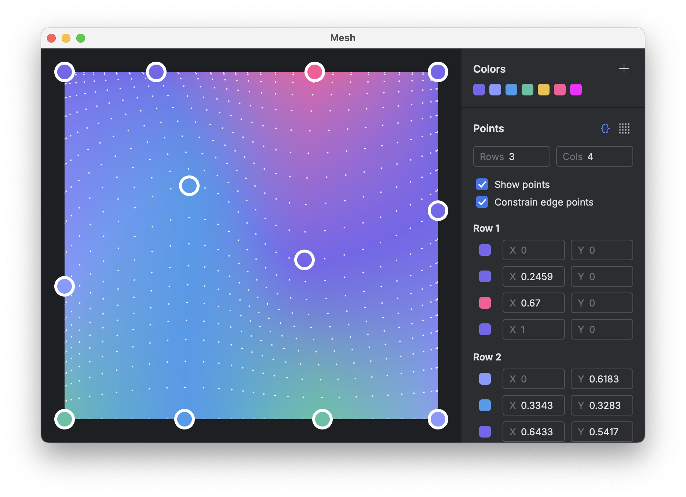

# Mesh

A desktop editor for creating mesh gradients in Compose, built with [Compose Multiplatform](https://www.jetbrains.com/compose-multiplatform/) and the [Jewel UI standalone toolkit](https://github.com/JetBrains/jewel). Gradients are rendered using [@sinasamaki](https://www.sinasamaki.com/mesh-gradients-in-jetpack-compose/)'s [`Modifier.meshGradient` implementation](https://gist.github.com/sinasamaki/05725557c945c5329fdba4a3494aaecb?ref=sinasamaki.com).

## Features and controls

- **Grid:** Adjust between 2–10 rows and columns, or distribute points evenly.
- **Control points:** Drag points on the canvas or edit `X`/`Y` offsets in the side panel. Double-click the canvas to hide or show points, and toggle edge constraints to lock perimeter points to the canvas bounds.
- **Palette:** Add hex colors to the saved palette, remove unused ones, and assign colors per point.
- **Canvas:** Configure canvas dimensions (fixed size or fill) and background color.
- **Export:** Copy Kotlin code (`Pair<Offset, Color>` point lists via KotlinPoet) for `@sinasamaki`'s `meshGradient` modifier, or export a PNG at 1x, 2x, or 3x scale.
- **Persistence:** Grid state and saved colors autosave locally to a Room/SQLite database.

### Roadmap

- [ ] Save and load configurations as documents
- [ ] Grain overlay
- [ ] Configurable gradient resolution
- [ ] Presets
- [ ] Gradient animation
- [ ] Undo/redo

## Running and packaging

Run from the command line (or use the `.run/desktopApp.run.xml` run configuration in IntelliJ IDEA):

```bash
./gradlew :composeApp:run
```

Build an unsigned macOS DMG for local testing:

```bash
./gradlew :composeApp:packageDmg
```

Build a signed and notarized release DMG (see [docs/RELEASING.md](docs/RELEASING.md) for signing setup):

```bash
./gradlew :composeApp:notarizeDmg
```

## License

[Apache 2.0](LICENSE)
